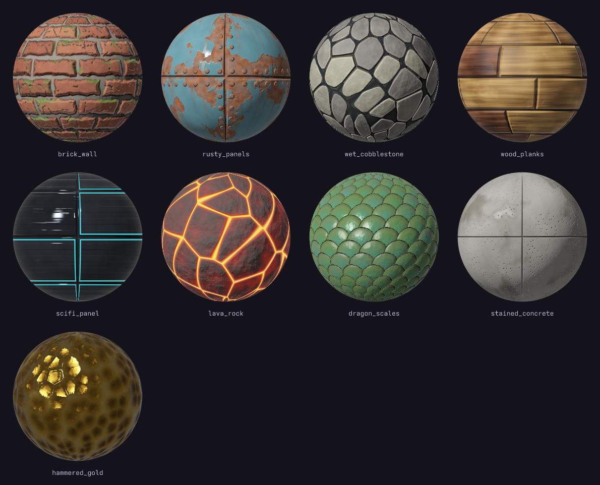
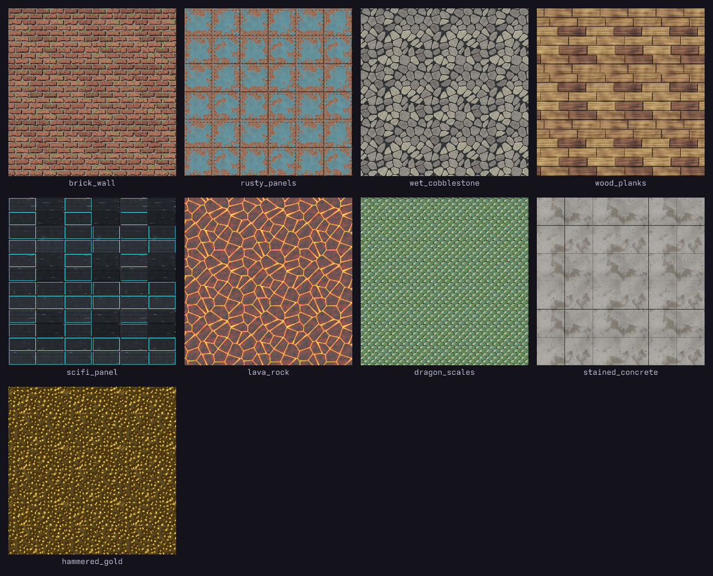

# loom

**Seamless game textures and PBR materials as code.** Write a small `.tx.js` file of fields
(noise, cells, bricks, planks, scales, ...) combined with operators and weathering masks; loom
writes every map an engine needs: albedo, normal, 16-bit height, roughness, metallic, AO, a packed
ORM and emissive. Every generator and operator tiles, so **materials are seamless by construction**,
and each build reports a seam check to prove it.

Built for AI agents (it ships as a Claude Code skill). Every build writes a **preview sheet**: the
material tiled 3×3 under a raking light, on a lit sphere and an isometric cube, and every map, so
the agent judges its textures the way it reads its code. A live viewer rebuilds on save.

Part of a family with [**vex**](https://github.com/uilianks/vex) (vector art, skeletal animation),
[**pxl**](https://github.com/uilianks/pxl) (pixel art), [**chirp**](https://github.com/uilianks/chirp)
(game audio) and [**kiln**](https://github.com/uilianks/kiln) (low-poly and voxel 3D). Inspired by
[**claude-pxl**](https://github.com/crsolver/claude-pxl), with the same architecture: sandboxed source
files, lazy cached builds, errors with exact locations, a live viewer and an annotate-and-send
feedback loop.

## In a 3D scene

[](https://github.com/uilianks/kiln#the-dragons-hoard-textured-with-loom)

*The Dragon's Hoard*, built in [**kiln**](https://github.com/uilianks/kiln) and rendered in Blender:
mossy brick, wet cobblestone, stained concrete, worn wood, rusted iron, glowing lava rock, dragon
scales and hammered gold, all from [`showcase/materials.tx.js`](showcase/materials.tx.js). A kiln
palette entry points at a loom output folder (`{ tex: "…/brick_wall", uv: 1.5 }`) and the GLB embeds
the albedo, normal, ORM and emissive maps.

## Showcase

Nine materials from [`showcase/materials.tx.js`](showcase/materials.tx.js), about 15 lines each.



Each one tiled 3×3: no seams.



| Material | Built from |
|---|---|
| brick_wall | `bricks` with wobble, chipped by thresholded `ridged`, grime in `cavity()`, moss on `facing("up")` |
| rusty_panels | `tiles` + rivets (`dots` along `.dist`), paint flaking from the edges, rust in the seams with `drips()` |
| wet_cobblestone | `cells().edge` stones, per-stone hue from `.id`, mud and puddles in the blurred gaps |
| wood_planks | `planks` with `.grain`, per-board tone, scuffs |
| scifi_panel | `tiles`, grooves, emissive light strips on some plates, scratches from stretched `ridged` |
| lava_rock | `cells` crust over glowing `emit` magma in the cracks |
| dragon_scales | overlapping `scales`, hue sheen per scale, metallic gold rims |
| stained_concrete | poured `noise`, pits, saw-cut seams, wet stains with low roughness |
| hammered_gold | `cells` dents hammered into the metal, tarnish in the hollows |

## Quick start

```bash
git clone https://github.com/uilianks/loom && cd loom
npm install
node bin/loom.js build showcase/materials.tx.js     # -> showcase/out/<name>/*.png + previews
node bin/loom.js serve showcase/materials.tx.js     # live viewer on http://127.0.0.1:4350
```

Requires Node ≥ 22.18 (it runs the TypeScript sources directly).

```js
pal({ brick: "#8e4a35", brickL: "#b46a4c", brickD: "#5e2c22", mortar: "#9c968a", grime: "#2b2622", moss: "#4c6a2c" })

const b = bricks({ rows: 10, cols: 4, gap: 0.014, bevel: 0.02, wobble: 0.5, seed: 3 })
const grain = noise({ scale: 24, octaves: 4 })
const height = b.mul(0.85).add(grain.mul(0.1))
const grime = height.cavity(0.006, 16).max(b.mask.invert().mul(0.5))
const moss = height.facing("up", 4).mul(noise({ scale: 6, seed: 9 }).threshold(0.58, 0.2)).mul(b.mask)

material("brick_wall", { size: 512, depth: 0.03 }, {
  height,
  color: ramp(b.id.mix(grain, 0.35), ["brickD", "brick", "brickL"])
    .mix("mortar", b.mask.invert()).mix("grime", grime.mul(0.6)).mix("moss", moss.mul(0.85)),
  rough: grain.levels(0, 1, 0.75, 0.95).mix(0.6, moss),
})
```

## Features

- **Generators**: fractal and ridged noise (stretchable for grain and streaks), Worley cells with
  edges and ids, dots, running-bond bricks, tiles, hexagons, planks with grain, overlapping scales,
  stripes and waves. Patterns expose `.mask`, `.id` (a random value per piece) and `.dist`.
- **Operators**: arithmetic, mix, levels, smoothstep, threshold, normalize, blur, domain warp,
  offset, repeat, quarter-turn rotate and flip, all wrapping at the tile edge.
- **Weathering from height**: `cavity()` for grime, `convex()` for worn edges, `facing("up")` for
  moss and dust, `drips()` for rust and rain streaks.
- **Maps**: albedo, tangent-space normal (GL or DX), 16-bit height, roughness, metallic, AO derived
  from height, ORM pack and emissive, plus a JSON manifest per material.
- **Seam check** on every build, and periods, repeats and rotations that would break tiling are refused.
- **Live viewer**: lit plane, sphere and cube with a draggable light, every map, every named field.
- **Annotate mode**: draw on the texture, pin notes and *send to Claude*; the feedback records what the
  material and every named field are at each marked pixel.
- **Errors** point at `file:line:col` with "did you mean" suggestions.

## Use as a Claude Code skill

```bash
git clone https://github.com/uilianks/loom ~/.claude/skills/loom-textures && (cd ~/.claude/skills/loom-textures && npm install)
```

Then ask Claude for a material ("a mossy castle wall", "rusted ship hull", "a stylized grass tile").
[SKILL.md](SKILL.md) teaches the workflow and the habits that make materials read as real; the full
API is in [reference.md](reference.md).

## Development

```bash
npm run check          # type check + tests (seamlessness of every generator and op, normals, errors, outputs, feedback)
node scripts/gallery.ts  # regenerate docs/media/gallery.png and tiled.png
```

## License

[MIT](LICENSE). Inspired by and partly adapted from [claude-pxl](https://github.com/crsolver/claude-pxl)
by crsolver; see [NOTICE](NOTICE).
